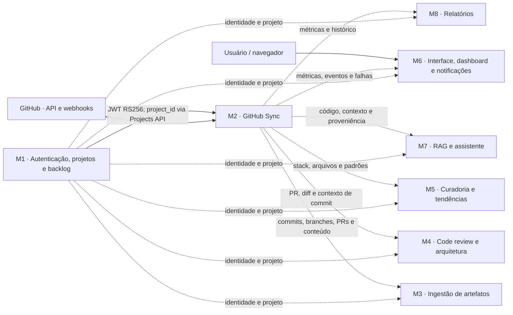
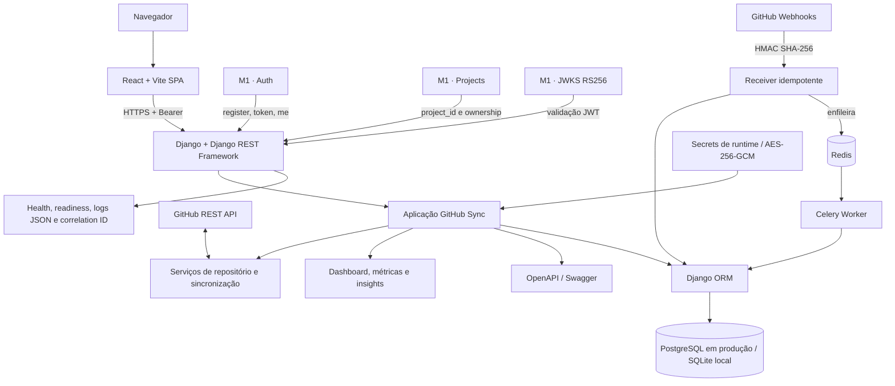

# P9 — arquitetura da solução no Miro

Este documento é o roteiro de montagem do quadro compartilhado da P9. Ele separa o que é comum à plataforma do que pertence à arquitetura interna de cada grupo, evitando que um módulo invente detalhes de implementação dos demais.

Imagem de referência pronta para inserir no Miro: [p9-arquitetura-miro-modulo-2.png](assets/p9-arquitetura-miro-modulo-2.png).

## O que a P9 pede

- diagrama da arquitetura do nosso módulo, incluindo dependências externas;
- diagrama da arquitetura do sistema completo, que pode ser o mesmo para todos os grupos;
- microserviços, bancos de dados e arquitetura interna de cada microserviço visíveis;
- entrega indicada no material do laboratório: até **01/11/2026**.

## Organização recomendada do Miro

Crie um quadro com estes frames:

1. `00 — Legenda e contratos`: cores, status das linhas e responsáveis;
2. `01 — Arquitetura geral da plataforma`: os oito módulos e os serviços externos, sem abrir a implementação interna de outros grupos;
3. `02 — Módulo 1 — Autenticação, projetos e backlog`: mantido pelo grupo do M1;
4. `03 — Módulo 2 — GitHub Sync`: o frame detalhado descrito neste documento;
5. `04` a `09 — Módulos 3 a 8`: um frame interno mantido por cada grupo;
6. `10 — Contratos e pendências`: URLs, OpenAPI, eventos, autenticação, responsáveis e status do E2E.

Regra de propriedade: cada grupo desenha e mantém a arquitetura interna do próprio módulo. O frame geral mostra somente fronteiras, contratos e dependências entre os módulos.

## Legenda

| Elemento | Significado |
| --- | --- |
| Linha azul contínua | integração implementada e verificada |
| Linha cinza tracejada | contrato previsto; depende de alinhamento ou implementação externa |
| Cartão verde | serviço operacional ou código verificado |
| Cartão amarelo | integração pronta no código, mas sem ambiente público confirmado |
| Cartão cinza | responsabilidade de outro grupo |
| Cilindro | armazenamento ou fila |

## Frame 01 — arquitetura geral da plataforma

As setas do M2 para os módulos 3 a 8 representam contratos de consumo esperados. Elas não devem ser marcadas como implementadas até que cada grupo publique uma URL, um contrato e um teste de integração.

## Frame 03 — arquitetura interna do Módulo 2

### Responsabilidades internas

| Camada | Responsabilidade |
| --- | --- |
| React + Vite | interface específica do Módulo 2: navegação, login/cadastro, seleção/criação de projeto, conexão e visualização sem dados fictícios |
| Django/DRF | fachada same-origin, autenticação, autorização, APIs e documentação OpenAPI |
| Serviços GitHub | handshake, metadados, commits, branches, PRs, conteúdo, diff e sincronização incremental |
| Webhook + Celery | validação HMAC, idempotência, persistência da entrega, retry e processamento assíncrono |
| PostgreSQL/ORM | repositórios, fatos Git, entregas, ownership e vínculo com `project_id` |
| Redis | broker e backend de resultados do Celery |
| Observabilidade | health, readiness, conectividade GitHub, logs estruturados e IDs de correlação |

## Dependências externas do Módulo 2

| Dependência | Uso | Estado |
| --- | --- | --- |
| M1 Auth | cadastro, login, `me`, JWT RS256 e JWKS | implementado e testado contra o ambiente publicado do M1 |
| M1 Projects | listar/criar projeto e validar propriedade do `project_id` | implementado e testado contra o ambiente publicado do M1 |
| GitHub API | validar credencial, consultar e sincronizar repositório | implementado no código; exige credencial e rede no ambiente |
| GitHub Webhooks | receber eventos de push/PR com HMAC | implementado no código; exige URL HTTPS pública para configurar o webhook |
| PostgreSQL | persistência de produção | previsto na composição/deploy; depende do ambiente operacional |
| Redis/Celery | fila e processamento assíncrono | previsto na composição/deploy; depende do ambiente operacional |
| Azure App Service | publicação do M2 | workflow existe, mas o hostname público anterior não está disponível |

## Contratos para puxar dos outros grupos

Para cada módulo, peça e registre no frame `10 — Contratos e pendências`:

- URL base pública e endpoint de `health`/`readiness`;
- link do OpenAPI/Swagger e versão do contrato;
- autenticação esperada, claims e escopos;
- IDs compartilhados (`project_id`, `user_id`, `repository_id`) e quem é o dono de cada dado;
- chamadas síncronas e eventos/webhooks assíncronos;
- payload de exemplo, códigos de erro e política de retry/idempotência;
- CORS, limites, timeout, SLA e comportamento quando o serviço estiver indisponível;
- secrets necessários e forma segura de distribuição;
- responsável técnico e evidência de um teste ponta a ponta.

## O que não deve ser apresentado como pronto

- equipes, papéis e permissões por função do M1 ainda não foram publicados;
- integrações M2 → M3/M4/M5/M6/M7/M8 são contratos previstos até haver URL e teste real dos consumidores;
- API Gateway e Data Bus permanecem `A definir` até existir um contrato comum da turma;
- cada módulo deve representar o próprio banco; não existe um banco compartilhado da plataforma;
- o deploy público do M2 precisa ser restabelecido antes de divulgar uma mensagem de consumo para a turma;
- recursos visuais ainda sem backend devem permanecer visíveis somente como `Em desenvolvimento` ou `Em breve`, sem números ou ações fictícias.

## Checklist de entrega

- [ ] imagem de referência inserida no Miro;
- [ ] frame geral revisado por todos os grupos;
- [ ] frame interno do M2 atualizado com a URL pública real;
- [ ] cada grupo criou seu próprio frame interno;
- [ ] bancos e filas identificados por módulo;
- [ ] linhas contínuas e tracejadas conferidas contra testes reais;
- [ ] links do OpenAPI e health anexados aos cartões;
- [ ] responsáveis e pendências externas visíveis;
- [ ] cada integrante enviou a entrega conforme a orientação da disciplina.
